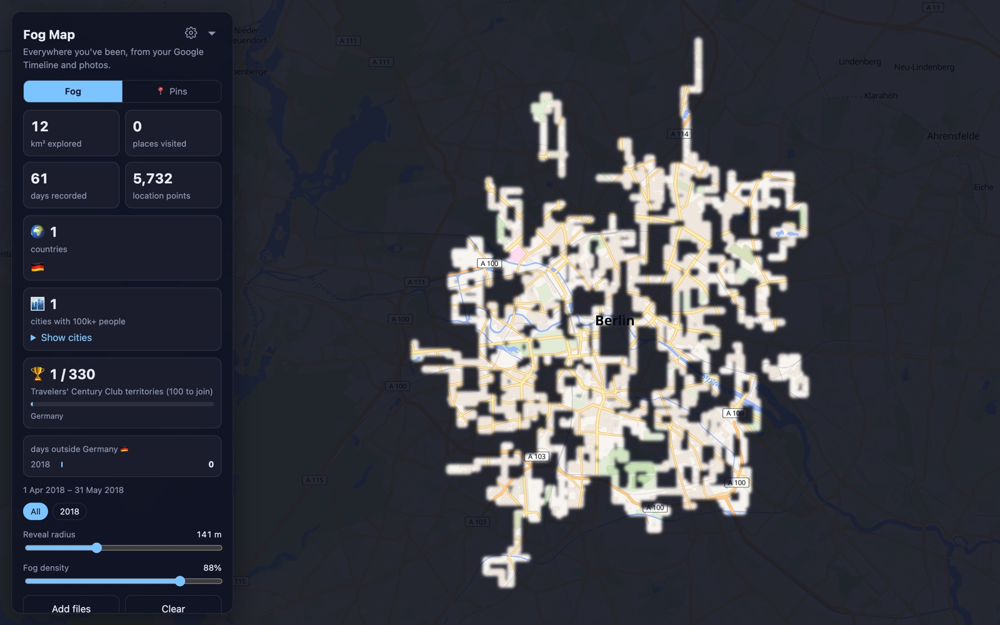
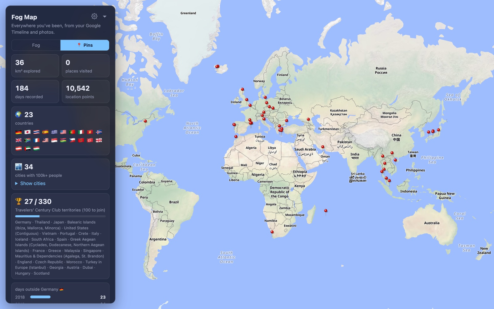
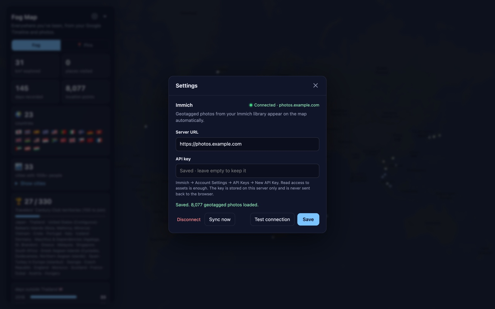

<div align="center">

# Fog Map

**A self-hosted map of everywhere you've been — built from your Google Timeline and your Immich photo library.**

[](https://github.com/MateuszKukiela/fog-map/actions/workflows/ci.yml)
[](https://github.com/MateuszKukiela/fog-map/pkgs/container/fog-map)
[](LICENSE)



</div>

The whole world starts covered in fog. Every street you walked, every town you stayed in and every
photo you took clears a little of it. Switch to the pin view for a classic wall map with a red pin in
every place you've been, and keep score: countries, cities, Travelers' Century Club territories and
days abroad, year by year.

Your data never leaves your server. There are no accounts, no tracking and no third-party scripts;
the only outside requests are map tiles.

## Features

- **Fog of war** — your GPS tracks, visits and photos reveal the map; adjustable reveal radius and fog density.
- **Wall-map pins** — a red push-pin on every city and every place you actually stopped at (not the ones you just drove through).
- **Immich integration** — enter your server URL and API key in the settings; geotagged photos appear automatically and stay in sync.
- **Google Timeline** — reads the on-device Timeline export from Android and iPhone, plus legacy Takeout `Records.json` and Semantic Location History.
- **Counters** — countries with flags, cities over 100k people, [Travelers' Century Club](https://travelerscenturyclub.org) territories (n / 330) and days abroad per year. Your home country is detected automatically.
- **Year filter** — see one year, or several, at a time.
- **Noise cleanup** — GPS glitches, photos taken from plane windows, airport layovers and one-off stray points don't count.
- **Manual places** — add trips from before your data starts (`manual-places.json`).
- **Tiny and dependency-free** — plain JavaScript, a ~200-line Node server, no database, no build step. Multi-arch image for amd64 and arm64 (Raspberry Pi).

<table>
  <tr>
    <td></td>
    <td></td>
  </tr>
  <tr>
    <td align="center">Pin view and counters</td>
    <td align="center">Immich connection</td>
  </tr>
</table>

## Quick start

```sh
docker run -d --name fog-map -p 8080:8080 -v fog-map-data:/data \
  -e BASIC_AUTH='me:choose-a-password' \
  ghcr.io/mateuszkukiela/fog-map:latest
```

Open <http://localhost:8080>, sign in, and click **⚙** to connect Immich.

Or with Docker Compose — save [`docker-compose.yml`](docker-compose.yml) and run:

```sh
docker compose up -d
```

## Adding your data

### Immich photos

1. In Immich: **Account Settings → API Keys → New API Key**. Read access to assets is enough.
2. In Fog Map: **⚙ → Immich**, enter the server URL and the key, click **Test connection**, then **Save**.

Photos load automatically every time you open the page; results are cached on the server for 6 hours
and **Sync now** refreshes them. The API key is stored on the server only and is never sent back to the browser.

### Google Timeline

Google keeps Timeline on your phone, so export it from there and drop the file on the page:

| Phone | Steps |
|---|---|
| Android | Settings → Location → Location services → Timeline → **Export Timeline data** → `Timeline.json` |
| iPhone | Google Maps → your profile picture → Your Timeline → ⋯ → Location & privacy settings → **Export Timeline data** |

Old Google Takeout exports work too: drop `Records.json` or the whole `Semantic Location History` folder.
You can drop several files at once (exports from different phones are merged), remove any file with ✕,
and dropping a file with the same name replaces the old one. Dropped files are stored in your browser
(IndexedDB), not on the server.

### Manual places

For trips that aren't in your data, create `manual-places.json` and drop it on the page:

```json
{
  "source": "manual",
  "places": [
    { "name": "San Marino", "lat": 43.9356, "lng": 12.4473, "date": "2015-07-20" },
    { "name": "London", "lat": 51.5074, "lng": -0.1278, "date": "2010-11-08", "to": "2010-11-21" }
  ]
}
```

`date` is the first day and the optional `to` the last day of the stay. Manual places always count.

## Configuration

Everything can be set in the page. Environment variables are optional:

| Variable | Default | Description |
|---|---|---|
| `BASIC_AUTH` | — | `user:password` login for the whole site. **Set it whenever anyone else can reach the page.** |
| `IMMICH_URL`, `IMMICH_API_KEY` | — | Starting values for the Immich connection. Settings saved in the page take precedence. |
| `IMMICH_REFRESH_HOURS` | `6` | How long Immich results are cached on the server. |
| `DATA_DIR` | `/data` | Where settings are stored. Mount a volume here. |
| `PORT` | `8080` | HTTP port inside the container. |

Image tags: `latest` and `1`, `1.0`, `1.0.0` for releases, `edge` for the newest `main` build.

## Security

- **Use `BASIC_AUTH` or put the app behind your own authentication** (Authelia, Authentik, Cloudflare Access…)
  if it's reachable by anyone but you. The map shows where every one of your photos was taken, and the
  settings let visitors change the Immich connection.
- The Immich API key is saved in `DATA_DIR/settings.json` with `0600` permissions and never returned by the API.
  Changing the server URL requires entering the key again, so a saved key can't be redirected to another host.
- Settings can only be changed with JSON requests, which other websites can't forge from your browser.
- The server serves an explicit allowlist of files; nothing else in the image or volume is reachable.
- The server runs as an unprivileged user (the entrypoint only uses root to make `/data` writable,
  so bind mounts work without a manual `chown`) and has a health check at `/healthz`.
- Behind a forward-auth proxy (tinyauth, Authelia, Authentik…) you don't need `BASIC_AUTH`.
  Leave `/healthz` reachable for health checks if your proxy monitors the app.
- When put behind a reverse proxy, terminate HTTPS there.

Found a vulnerability? See [SECURITY.md](SECURITY.md).

## How the counting works

Location data is noisy, so a few rules decide what counts:

- **In flight** — fixes reached and left at more than 250 km/h are dropped (plane-window photos, GPS on flights).
- **Teleports** — a small burst of points far away with the same place before and after, reached faster than any plane, is a geolocation glitch and is dropped.
- **One-off countries** — a foreign country counts only if you spent an hour there that day or it shows up again within a week.
- **Airports** — layovers don't count as visiting a country or a city (they do count for the Century Club, whose rules include transit stops).
- **Days abroad** — short gaps without data inside a trip (up to 5 days, with no sign of being home) are filled in.
- **Pins** — cities with 100k+ people get a pin when you've been there; smaller places need a real stop: 45+ minutes, or 15+ minutes with a few photos.

## Development

No dependencies, no build. Node 20+.

```sh
npm test          # parser and server tests
npm start         # http://localhost:8080
```

`index.html` also works opened straight from disk; then drop files on it, and export Immich photos with
`IMMICH_URL=… IMMICH_API_KEY=… node immich-export.mjs`.

| File | What it does |
|---|---|
| `server.mjs` | HTTP server: static files, settings, Immich sync, login |
| `immich.mjs` | Immich API client (shared with `immich-export.mjs`) |
| `parser.js` | Reads every supported export format |
| `fog.js` | Fog rendering and exploration statistics |
| `app.js` | UI, counters, pins, noise cleanup |
| `countries.js`, `tcc.js`, `cities.js`, `towns.js`, `airports.js` | Bundled reference data |
| `vendor/maplibre-gl/` | [MapLibre GL JS](https://maplibre.org) 4.7.1 (BSD-3-Clause), bundled so pages load no third-party scripts |

## Data sources

- Country borders: [Natural Earth](https://www.naturalearthdata.com) (public domain)
- Cities and towns: [GeoNames](https://www.geonames.org) ([CC BY 4.0](https://creativecommons.org/licenses/by/4.0/))
- Airports: [OurAirports](https://ourairports.com) (public domain)
- Territory list: [Travelers' Century Club](https://travelerscenturyclub.org/countries-and-territories/) (territory boundaries are approximations)
- Map tiles: [OpenFreeMap](https://openfreemap.org), © [OpenStreetMap](https://www.openstreetmap.org/copyright) contributors

Fog Map is not affiliated with Google, Immich or the Travelers' Century Club.

## License

[MIT](LICENSE)
